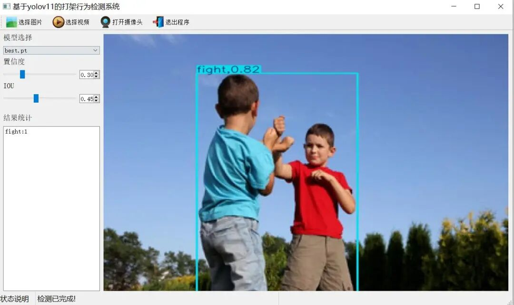
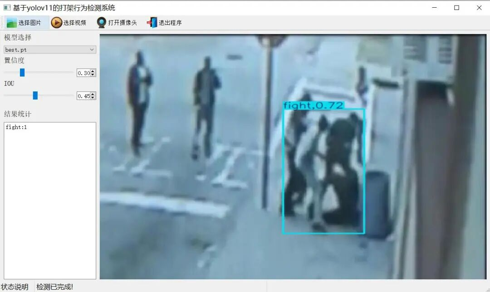
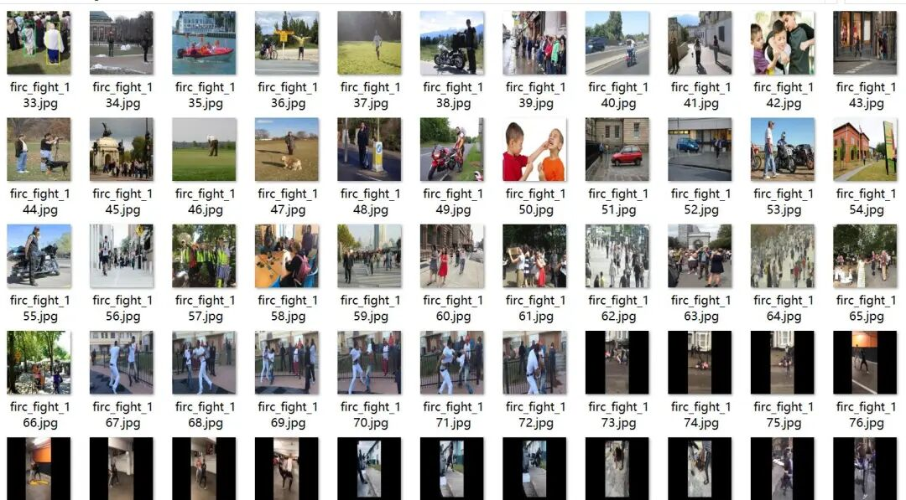
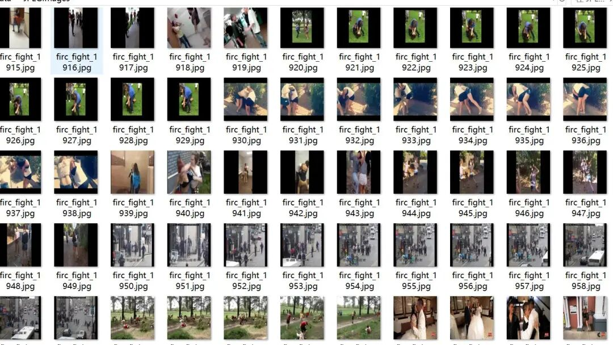
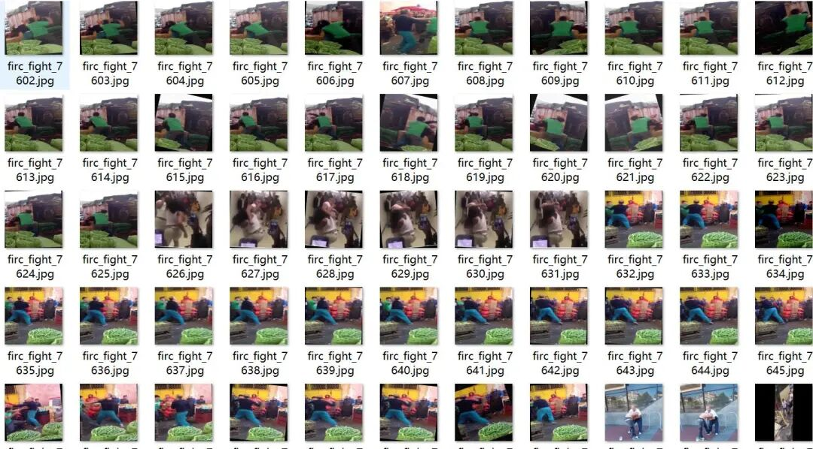
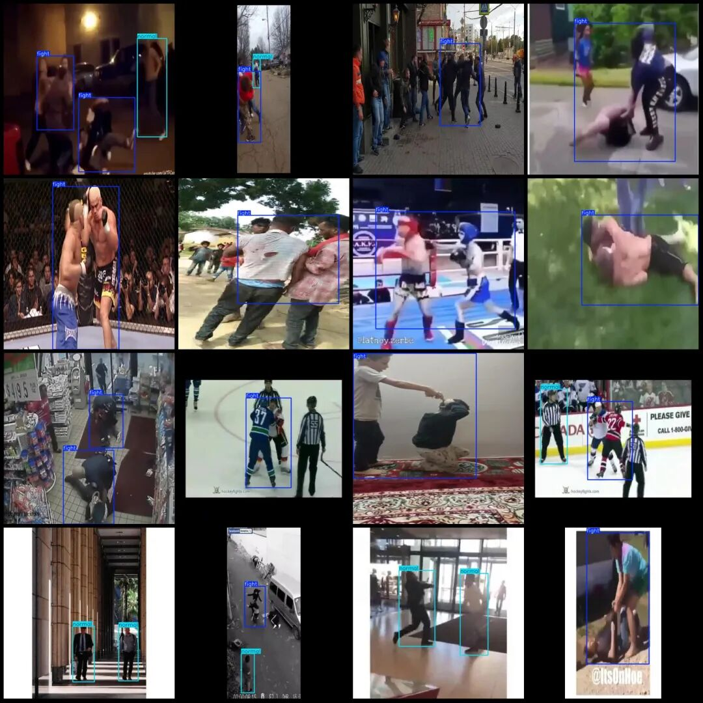

# Fighting Behavior Detection System Based on Yolov11 in Python Source Code + PyTorch Model + Evaluation Indicator Curve + Beautiful GUI Interface

[Algorithm Background Introduction]In the important stage of advancing towards intelligence and precision in public security management, it is crucial to timely and accurately monitor fights in public places.

[Algorithm Background Introduction]

In the critical phase of advancing social security management towards intelligence and refinement, timely and precise monitoring of fights in public places has become one of the core tasks to maintain social order stability, ensure the safety of citizens, and enhance urban governance. Public places, as densely populated and frequently moving areas with complex and variable environments, are difficult to predict human behavior. The density of people and their composition vary greatly across different locations, and activities are diverse. Additionally, there may be factors such as varying lighting conditions, crowd obstruction, and background noise present on-site. These conditions not only directly reflect the current state of social security and the effectiveness of management but also are closely linked to public safety, social harmony, and the city's civilized image.Once fighting occurs in public places, such as physical altercations triggered by disputes within shopping malls, escalated violent brawls due to verbal altercations on the streets, or chaos and fights caused by mass events, if not detected and quickly stopped in time, it is highly likely to lead to injuries to individuals, property damage, and even trigger larger-scale mass incidents, posing significant negative impacts and risks to society.

Traditional methods for monitoring fights in public places mainly rely on security personnel conducting on-site patrols and manual inspection of surveillance footage by personnel in the control room. However, due to factors such as the expanding area of public spaces, increased speed of personnel movement, and the abundance of surveillance footage, manual patrols are difficult to comprehensively cover every corner of public places. Especially in areas that are remote, dark, or densely populated, sudden fights are often missed in time. Moreover, early methods based on simple human judgment had a high misjudgment rate of over 40%, which could not meet the "precision and all-round" needs of social security management. Therefore, developing an intelligent detection system for fights in public places with high precision, strong adaptability, and real-time monitoring has become a key technical breakthrough point in improving the level of social security management and governance efficiency.

Currently, existing technologies face several significant bottlenecks: manual patrols are not only extremely inefficient (it is challenging for security personnel to inspect large public areas within a short time frame), but they also carry the risk of being harmed by violent acts; traditional algorithms based on simple action feature extraction struggle to accurately distinguish normal behavior from fighting (for instance, some intense sports activities and playful scuffles may resemble fighting actions), and their performance deteriorates dramatically in complex environments with dim lighting and high crowd density; traditional target detection models have poor adaptability to the variability of human behavior (such as differences in fighting actions among individuals of different ages and genders) and scale changes (from minor pushing and shoving to intense punching and kicking). They have an over-50% missed rate for small-scale, covert fighting behaviors (such as two people quietly grappling), which fails to meet the complex demands of real-world social security management.

The fighting behavior detection system based on YOLOv11 has brought revolutionary changes to public security management. As an advanced target detection algorithm, YOLOv11 possesses strong feature extraction and real-time detection capabilities. This system fully leverages the end-to-end real-time detection advantages of YOLOv11 and has been deeply optimized for complex environments in public places.

This system can precisely identify the key categories of "normal" (normal behavior) and "fight" (fighting behavior). It can accurately capture various action features of fighting behavior, whether it is a slight push, pull, or intense punching, kicking, and throwing; whether it is a one-on-one fight between two people, or a group fight involving multiple people. The system can also sensitively identify normal behaviors such as walking, standing, talking, shopping, etc. Through learning and training with a large amount of public place fighting behavior video data, the system can maintain a high detection accuracy. Even in complex scenarios with large changes in lighting, fast personnel flow, various obstructions and interferences, the system can still perform stably.

At the same time, The system has strong anti-interference ability. Can effectively deal with public places' billboards. Vehicles Trees and other interference factors, There will be no misjudgment or omission due to these disturbances. This provides solid technical support for the construction of new intelligent social security. Assisting relevant departments to achieve efficient... Precise Scientific public security management. Timely identify and stop fighting behavior. To maintain the normal progress of social order and the stable and reliable safety of citizens' lives. Enhance the core competitiveness and civilized image of the city.

[Effect Display]


Editor


Editor

[Test Environment]

windows10
anaconda3+python3.8
torch==2.3.1
ultralytics==8.3.120

The model can detect the category.

normal

fight

[Training Dataset Introduction]

Some augmented images are included in the dataset. The main enhancement is rotation. Additionally, the dataset consists of many video clips. Note that normal is a negative sample. Therefore, some people can omit annotations for the sake of filtering out non-fighting situations. Marked as background training.

Dataset format: Pascal VOC format + YOLO format (txt file without split path, only contains jpg images and corresponding VOC format xml files and yolo format txt files)

Number of images (number of jpg files): 9168

Number of annotations (number of xml files): 9168

Number of annotations (number of txt files): 9168

Labeling category count: 2

Label category names (Note that the order of categories in the YOLO format does not correspond to this, but is based on the classes.txt file in the labels folder): ["fight", "normal"]

Number of boxes labeled in each category:

Fight Frames = 6967

Normal frame count = 9725

Total frame count: 16692

Using labelImg:

Annotation rules: Draw a rectangle around the category.

Important Notice: The dataset introduction and the actual training dataset may have inconsistencies due to the verification review count, but overall they are consistent.

Special : This dataset does not guarantee the accuracy of the trained models or weight files.

Image Preview:



Editor



Editor



Editor

Annotation example:



Editor

[Training Information]


Parameters


Value


Number of training set images


6786


Number of images in the validation set


1397


Training map


87.5%


Training Accuracy


83.5%


Training recall rate


82.4%


Validation set accuracy statistics:


Class


Images


Instances


P


R


mAP50


mAP50-95


all


1397


2649


0.835


0.824


0.875


0.638


normal


777


1538


0.785


0.768


0.821


0.583


fight


1071


1111


0.885


0.88


0.93


0.692


[Interface Design]

```
class Ui_MainWindow(QtWidgets.QMainWindow):
signal = QtCore.pyqtSignal(str, str)
def setupUi(self):
self.setObjectName("MainWindow")
self.resize(1280, 728)
self.centralwidget = QtWidgets.QWidget(self)
self.centralwidget.setObjectName("centralwidget")
self.weights_dir = './weights'
self.picture = QtWidgets.QLabel(self.centralwidget)
self.picture.setGeometry(QtCore.QRect(260, 10, 1010, 630))
self.picture.setStyleSheet("background:black")
self.picture.setObjectName("picture")
self.picture.setScaledContents(True)
self.label_2 = QtWidgets.QLabel(self.centralwidget)
self.label_2.setGeometry(QtCore.QRect(10, 10, 81, 21))
self.label_2.setObjectName("label_2")
self.cb_weights = QtWidgets.QComboBox(self.centralwidget)
self.cb_weights.setGeometry(QtCore.QRect(10, 40, 241, 21))
self.cb_weights.setObjectName("cb_weights")
self.cb_weights.currentIndexChanged.connect(self.cb_weights_changed)
self.label_3 = QtWidgets.QLabel(self.centralwidget)
self.label_3.setGeometry(QtCore.QRect(10, 70, 72, 21))
self.label_3.setObjectName("label_3")
self.hs_conf = QtWidgets.QSlider(self.centralwidget)
self.hs_conf.setGeometry(QtCore.QRect(10, 100, 181, 22))
self.hs_conf.setProperty("value", 25)
self.hs_conf.setOrientation(QtCore.Qt.Horizontal)
self.hs_conf.setObjectName("hs_conf")
self.hs_conf.valueChanged.connect(self.conf_change)
self.dsb_conf = QtWidgets.QDoubleSpinBox(self.centralwidget)
self.dsb_conf.setGeometry(QtCore.QRect(200, 100, 51, 22))
self.dsb_conf.setMaximum(1.0)
self.dsb_conf.setSingleStep(0.01)
self.dsb_conf.setProperty("value", 0.25)
self.dsb_conf.setObjectName("dsb_conf")
self.dsb_conf.valueChanged.connect(self.dsb_conf_change)
self.dsb_iou = QtWidgets.QDoubleSpinBox(self.centralwidget)
self.dsb_iou.setGeometry(QtCore.QRect(200, 160, 51, 22))
self.dsb_iou.setMaximum(1.0)
self.dsb_iou.setSingleStep(0.01)
self.dsb_iou.setProperty("value", 0.45)
self.dsb_iou.setObjectName("dsb_iou")
self.dsb_iou.valueChanged.connect(self.dsb_iou_change)
self.hs_iou = QtWidgets.QSlider(self.centralwidget)
self.hs_iou.setGeometry(QtCore.QRect(10, 160, 181, 22))
self.hs_iou.setProperty("value", 45)
self.hs_iou.setOrientation(QtCore.Qt.Horizontal)
self.hs_iou.setObjectName("hs_iou")
self.hs_iou.valueChanged.connect(self.iou_change)
self.label_4 = QtWidgets.QLabel(self.centralwidget)
self.label_4.setGeometry(QtCore.QRect(10, 130, 72, 21))
self.label_4.setObjectName("label_4")
self.label_5 = QtWidgets.QLabel(self.centralwidget)
self.label_5.setGeometry(QtCore.QRect(10, 210, 72, 21))
self.label_5.setObjectName("label_5")
self.le_res = QtWidgets.QTextEdit(self.centralwidget)
self.le_res.setGeometry(QtCore.QRect(10, 240, 241, 400))
self.le_res.setObjectName("le_res")
self.setCentralWidget(self.centralwidget)
self.menubar = QtWidgets.QMenuBar(self)
self.menubar.setGeometry(QtCore.QRect(0, 0, 1110, 30))
self.menubar.setObjectName("menubar")
self.setMenuBar(self.menubar)
self.statusbar = QtWidgets.QStatusBar(self)
self.statusbar.setObjectName("statusbar")
self.setStatusBar(self.statusbar)
self.toolBar = QtWidgets.QToolBar(self)
self.toolBar.setToolButtonStyle(QtCore.Qt.ToolButtonTextBesideIcon)
self.toolBar.setObjectName("toolBar")
self.addToolBar(QtCore.Qt.TopToolBarArea, self.toolBar)
self.actionopenpic = QtWidgets.QAction(self)
icon = QtGui.QIcon()
icon.addPixmap(QtGui.QPixmap(":/images/1.png"), QtGui.QIcon.Normal, QtGui.QIcon.Off)
self.actionopenpic.setIcon(icon)
self.actionopenpic.setObjectName("actionopenpic")
self.actionopenpic.triggered.connect(self.open_image)
self.action = QtWidgets.QAction(self)
icon1 = QtGui.QIcon()
icon1.addPixmap(QtGui.QPixmap(":/images/2.png"), QtGui.QIcon.Normal, QtGui.QIcon.Off)
self.action.setIcon(icon1)
self.action.setObjectName("action")
self.action.triggered.connect(self.open_video)
self.action_2 = QtWidgets.QAction(self)
icon2 = QtGui.QIcon()
icon2.addPixmap(QtGui.QPixmap(":/images/3.png"), QtGui.QIcon.Normal, QtGui.QIcon.Off)
self.action_2.setIcon(icon2)
self.action_2.setObjectName("action_2")
self.action_2.triggered.connect(self.open_camera)
self.actionexit = QtWidgets.QAction(self)
icon3 = QtGui.QIcon()
icon3.addPixmap(QtGui.QPixmap(":/images/4.png"), QtGui.QIcon.Normal, QtGui.QIcon.Off)
self.actionexit.setIcon(icon3)
self.actionexit.setObjectName("actionexit")
self.actionexit.triggered.connect(self.exit)
self.toolBar.addAction(self.actionopenpic)
self.toolBar.addAction(self.action)
self.toolBar.addAction(self.action_2)
self.toolBar.addAction(self.actionexit)
self.retranslateUi()
QtCore.QMetaObject.connectSlotsByName(self)
self.init_all()
```

[Common Evaluation Parameters Introduction]

In the task of object detection, evaluating the performance of a model is crucial. The terms you mentioned are commonly used metrics for assessing the performance of a model. Here are detailed explanations of these terms:

Class:
This typically refers to the categories of objects that the model is designed to detect. For example, a model might be trained to detect vehicles, pedestrians, or animals among different categories.
Images:
Represents the number of images in the validation set. The validation set is used for evaluating the performance of the model and is separate from the training set to ensure fairness in evaluation results.
Instances:
Total number of target objects in all images. This includes the sum of all category objects, such as if the validation set contains 100 images, with an average of 5 target objects per image, then Instances would be 500.
P (Precision):
Precision is the ratio of true positives (TP) to the sum of true positives and false positives (FP). The formula is Precision = TP / (TP + FP), where TP represents true positives and FP represents false positives.
R (Recall):
Recall is the ratio of true positives (TP) to the sum of true positives and false negatives (FN). The formula is Recall = TP / (TP + FN), where FN represents false negatives.
mAP50:
Represents the mean Average Precision (mAP) at IoU threshold of 0.5. IoU is an indicator for measuring the overlap degree between predicted bounding boxes and ground truth bounding boxes. mAP is a comprehensive metric that considers both precision and recall, used to evaluate the performance of models at different recall levels. At IoU=0.5, if the overlap between predicted and ground truth bounding boxes reaches or exceeds 50%, it is considered correct.
mAP50-95:
This represents the average accuracy of the model across a range of IoU values from 0.5 to 0.95 (with an interval of 0.05). This is a more stringent evaluation criterion, demanding higher overlap between predicted bounding boxes and true ones. In object detection tasks, a higher IoU threshold means that the model needs to be more accurate in target object localization. The calculation of mAP50-95 takes into account multiple IoU thresholds ranging from lenient to strict, thus providing a comprehensive assessment of the model's performance.
These metrics collectively form an important framework for evaluating the performance of object detection models. By comparing the performance of different models on these metrics, it is possible to determine which model might be more effective in practical applications.

[Usage Steps]

Usage Steps:
1. Install the YOLOv11 environment according to the official framework ultralytics installation tutorial, and install PyQt5.
2. After switching to the YOLOv11 environment you have installed, and switch to the source code directory, execute python main.py to start the interface, and perform the corresponding operations.

[Provided Files]

Python source code
YOLOv11n.pt model
Training map, P, R curves (in weights\results.png)
Test images (under test_img folder)

Please provide the training dataset, and you can find the address in mytxt.txt file.


## Payment

Here is a pay link on Stripe ( https://buy.stripe.com/3cs8yP7sY87d0vu9AB ). Please contact me lonlonago@foxmail.com after funding $89, and I will send you a complete data files , thank you!


